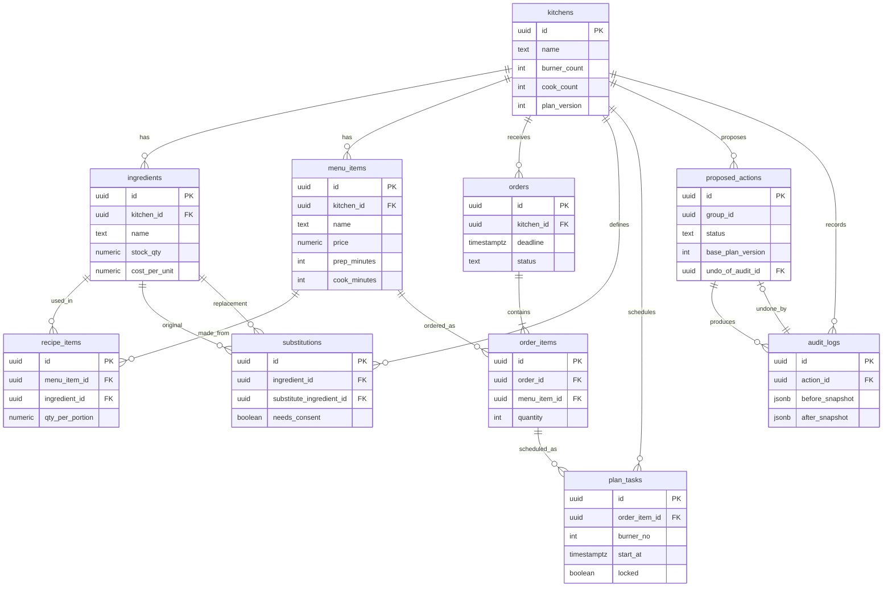

# OperAI: Database Schema

Postgres on Supabase. Derived from the OperAI PRD and System Architecture. All example data is **simulated** and labelled as such.

## 1. Design decisions

- **UUID primary keys** (`gen_random_uuid()`). Safe to generate anywhere, no guessable ids once auth arrives.
- **`kitchen_id` on every business table.** One kitchen now, multi-kitchen later with no migration (FUTURE: RLS policies on it).
- **`numeric` for money and quantities, never float.** Avoids rounding drift in profit math.
- **`timestamptz` everywhere.** Deadlines are stored in UTC and shown in IST.
- **`data_source` (`simulated` | `verified`)** on seeded tables, so the UI can label every figure honestly.
- **`jsonb` only where the shape varies:** option payloads, impact numbers, audit snapshots. Everything queried or joined is a real column.
- **Text + CHECK instead of Postgres enums.** Easier to change during a hackathon.
- **Additions to the architecture doc:** `kitchens.plan_version` (the counter used to detect stale proposals), `proposed_actions.group_id` (options generated together) and `stock_fingerprint` (revalidation at approval).
- **Dish swaps need no table.** Swap candidates are generated by rule: active menu items whose recipe is fully in stock and whose price is close to the original.

## 2. ER diagram



## 3. Tables

### 3.1 `kitchens`

One row per kitchen: capacity and cost assumptions the scheduler and pricing engine read.

| Column | Type | Constraints | Notes |
| --- | --- | --- | --- |
| id | uuid | PK, default gen\_random\_uuid() |  |
| name | text | NOT NULL |  |
| burner\_count | int | NOT NULL, CHECK > 0 | Scheduler capacity |
| cook\_count | int | NOT NULL, CHECK > 0 | Scheduler capacity |
| overhead\_pct | numeric(5,2) | NOT NULL, default 0 | Allocated overhead as % of price |
| commission\_pct | numeric(5,2) | NOT NULL, default 0 | Platform commission |
| target\_margin\_pct | numeric(5,2) | NOT NULL, default 25 | Used for suggested price |
| plan\_version | int | NOT NULL, default 1 | Incremented on every applied plan change |
| data\_source | text | NOT NULL, CHECK in (simulated, verified) |  |
| created\_at | timestamptz | NOT NULL, default now() |  |

**Indexes:** PK only.

### 3.2 `ingredients`

| Column | Type | Constraints | Notes |
| --- | --- | --- | --- |
| id | uuid | PK |  |
| kitchen\_id | uuid | FK to kitchens(id), NOT NULL |  |
| name | text | NOT NULL |  |
| unit | text | NOT NULL | kg, l, pcs |
| stock\_qty | numeric(10,3) | NOT NULL, CHECK >= 0 | Current stock |
| cost\_per\_unit | numeric(10,2) | NOT NULL, CHECK >= 0 |  |
| allergen\_tags | text\[\] | NOT NULL, default empty | e.g. dairy, soy |
| diet\_tags | text\[\] | NOT NULL, default empty | e.g. veg, vegan |
| data\_source | text | NOT NULL | simulated or verified |
| updated\_at | timestamptz | NOT NULL, default now() |  |

**Indexes:** UNIQUE (kitchen\_id, name); GIN on allergen\_tags (FUTURE, only if tag queries get slow).

### 3.3 `menu_items`

| Column | Type | Constraints | Notes |
| --- | --- | --- | --- |
| id | uuid | PK |  |
| kitchen\_id | uuid | FK to kitchens(id), NOT NULL |  |
| name | text | NOT NULL |  |
| price | numeric(10,2) | NOT NULL, CHECK >= 0 | Selling price |
| packaging\_cost | numeric(10,2) | NOT NULL, default 0 |  |
| prep\_minutes | int | NOT NULL | Cook-attended time |
| cook\_minutes | int | NOT NULL | Burner time |
| is\_active | boolean | NOT NULL, default true |  |
| data\_source | text | NOT NULL |  |

**Indexes:** UNIQUE (kitchen\_id, name); (kitchen\_id) WHERE is\_active.

### 3.4 `recipe_items`

Bridge between dishes and ingredients. Drives cost, the risk brief, and shortage detection.

| Column | Type | Constraints | Notes |
| --- | --- | --- | --- |
| id | uuid | PK |  |
| menu\_item\_id | uuid | FK to menu\_items(id) ON DELETE CASCADE, NOT NULL |  |
| ingredient\_id | uuid | FK to ingredients(id), NOT NULL |  |
| qty\_per\_portion | numeric(10,3) | NOT NULL, CHECK > 0 | In the ingredient's unit |

**Indexes:** UNIQUE (menu\_item\_id, ingredient\_id); (ingredient\_id) for reverse lookup ("which dishes use paneer?").

### 3.5 `substitutions`

Owner-approved substitutes only. The LLM may suggest, but only rows here (or rows the owner adds) are usable.

| Column | Type | Constraints | Notes |
| --- | --- | --- | --- |
| id | uuid | PK |  |
| kitchen\_id | uuid | FK to kitchens(id), NOT NULL |  |
| ingredient\_id | uuid | FK to ingredients(id), NOT NULL | Ingredient that ran short |
| substitute\_ingredient\_id | uuid | FK to ingredients(id), NOT NULL | CHECK differs from ingredient\_id |
| ratio | numeric(6,3) | NOT NULL, default 1 | Substitute qty per 1 unit of original |
| needs\_consent | boolean | NOT NULL, default true | Customer must agree first |
| notes | text |  | Quality or taste caveat |
| is\_active | boolean | NOT NULL, default true |  |

**Indexes:** UNIQUE (ingredient\_id, substitute\_ingredient\_id). Allergen and diet checks compare the two ingredients' tags at proposal time.

### 3.6 `orders`

| Column | Type | Constraints | Notes |
| --- | --- | --- | --- |
| id | uuid | PK |  |
| kitchen\_id | uuid | FK to kitchens(id), NOT NULL |  |
| customer\_name | text | NOT NULL |  |
| customer\_phone | text |  | Used for the wa.me draft |
| channel | text | NOT NULL, CHECK in (whatsapp, instagram, swiggy, zomato, direct) |  |
| deadline | timestamptz | NOT NULL | Delivery or pickup time |
| status | text | NOT NULL, default new | new, planned, in\_progress, delayed, partial, completed, cancelled |
| total\_amount | numeric(10,2) | NOT NULL |  |
| source\_text | text |  | Pasted WhatsApp message, stored as data only |
| extraction\_confidence | numeric(3,2) | CHECK between 0 and 1 | Set when created via paste |
| data\_source | text | NOT NULL |  |
| created\_at | timestamptz | NOT NULL, default now() |  |

**Indexes:** (kitchen\_id, deadline) for the evening-brief query; (kitchen\_id, status).

### 3.7 `order_items`

| Column | Type | Constraints | Notes |
| --- | --- | --- | --- |
| id | uuid | PK |  |
| order\_id | uuid | FK to orders(id) ON DELETE CASCADE, NOT NULL |  |
| menu\_item\_id | uuid | FK to menu\_items(id), NOT NULL | Current dish (changes on a swap) |
| quantity | int | NOT NULL, CHECK > 0 |  |
| unit\_price | numeric(10,2) | NOT NULL | Price snapshot at order time |
| swapped\_from\_item\_id | uuid | FK to menu\_items(id), NULL | Set when a dish swap was applied |

**Indexes:** (order\_id); (menu\_item\_id).

### 3.8 `plan_tasks`

The current schedule. One row per scheduled work block.

| Column | Type | Constraints | Notes |
| --- | --- | --- | --- |
| id | uuid | PK |  |
| kitchen\_id | uuid | FK to kitchens(id), NOT NULL |  |
| order\_item\_id | uuid | FK to order\_items(id) ON DELETE CASCADE, NOT NULL |  |
| task\_type | text | NOT NULL, CHECK in (prep, cook, pack) |  |
| burner\_no | int | NULL | Only for cook tasks |
| cook\_no | int | NOT NULL | Which cook |
| start\_at | timestamptz | NOT NULL |  |
| end\_at | timestamptz | NOT NULL, CHECK > start\_at |  |
| status | text | NOT NULL, default scheduled | scheduled, in\_progress, done, cancelled |
| locked | boolean | NOT NULL, default false | True for in-progress tasks; replan must not move them |
| plan\_version | int | NOT NULL | Version in which the row was written |

**Indexes:** (kitchen\_id, start\_at); (order\_item\_id). The solver reads rows where `status <> 'cancelled'`.

### 3.9 `proposed_actions`

Every consequential change starts here as `pending`. Nothing is applied until approval.

| Column | Type | Constraints | Notes |
| --- | --- | --- | --- |
| id | uuid | PK |  |
| kitchen\_id | uuid | FK to kitchens(id), NOT NULL |  |
| group\_id | uuid | NOT NULL | Options generated together share it |
| option\_number | int | NOT NULL | What the owner says: confirm option N |
| action\_type | text | NOT NULL, CHECK in (recovery, price\_change, order\_intake, undo) |  |
| title | text | NOT NULL | Short label for UI and voice |
| payload | jsonb | NOT NULL | The exact change to apply |
| impact | jsonb | NOT NULL | Late orders, ₹ at risk, extra cost, margin before/after, score |
| status | text | NOT NULL, default pending | pending, approved, executed, rejected, expired, failed |
| base\_plan\_version | int | NOT NULL | Must equal kitchens.plan\_version at approval |
| stock\_fingerprint | text | NOT NULL | Hash of relevant stock at proposal time |
| undo\_of\_audit\_id | uuid | FK to audit\_logs(id), NULL | Set only for undo actions |
| created\_at | timestamptz | NOT NULL, default now() |  |
| expires\_at | timestamptz | NOT NULL | Short TTL, e.g. 30 min |
| decided\_at | timestamptz | NULL |  |
| executed\_at | timestamptz | NULL |  |

**Indexes:** UNIQUE (group\_id, option\_number); (kitchen\_id, status, created\_at DESC).

### 3.10 `audit_logs`

Append-only history. Undo reads `before_snapshot`.

| Column | Type | Constraints | Notes |
| --- | --- | --- | --- |
| id | uuid | PK |  |
| kitchen\_id | uuid | FK to kitchens(id), NOT NULL |  |
| action\_id | uuid | FK to proposed\_actions(id), NULL | Null for system events |
| event\_type | text | NOT NULL | action\_executed, action\_rejected, undo\_executed, order\_created, stock\_updated |
| actor | text | NOT NULL, CHECK in (owner, system, agent) | Approvals are always owner |
| summary | text | NOT NULL | Human-readable line for the log screen |
| before\_snapshot | jsonb |  | Affected rows before the change |
| after\_snapshot | jsonb |  | Affected rows after the change |
| plan\_version\_before | int |  |  |
| plan\_version\_after | int |  |  |
| created\_at | timestamptz | NOT NULL, default now() |  |

**Indexes:** (kitchen\_id, created\_at DESC); (action\_id).

**Circular reference note:** `proposed_actions.undo_of_audit_id` points to `audit_logs`, and `audit_logs.action_id` points to `proposed_actions`. Create both tables first, then add one foreign key with `ALTER TABLE`. Both columns are nullable, so inserts never deadlock.

## 4. Relationships

| Relationship | Type | Via |
| --- | --- | --- |
| kitchens to ingredients, menu\_items, orders, substitutions, plan\_tasks, proposed\_actions, audit\_logs | one to many | kitchen\_id |
| menu\_items to ingredients | many to many | recipe\_items |
| ingredients to ingredients (substitutes) | many to many (self) | substitutions |
| orders to order\_items | one to many | order\_id |
| menu\_items to orders | many to many | order\_items |
| order\_items to plan\_tasks | one to many | order\_item\_id |
| proposed\_actions to audit\_logs | one to many | action\_id |
| audit\_logs to proposed\_actions (undo) | one to zero-or-one | undo\_of\_audit\_id |

## 5. Key queries and integrity rules

### 5.1 Evening risk brief (shortage detection)

```sql
SELECT i.name, i.stock_qty,
       SUM(oi.quantity * r.qty_per_portion) AS needed
FROM orders o
JOIN order_items oi ON oi.order_id = o.id
JOIN recipe_items r ON r.menu_item_id = oi.menu_item_id
JOIN ingredients i ON i.id = r.ingredient_id
WHERE o.kitchen_id = :kitchen_id
  AND o.deadline >= :day_start AND o.deadline < :day_end
  AND o.status NOT IN ('cancelled', 'completed')
GROUP BY i.id
HAVING SUM(oi.quantity * r.qty_per_portion) > i.stock_qty;
```

This is covered by the `(kitchen_id, deadline)` index on orders and the `recipe_items` unique index.

### 5.2 Approval transaction (atomic and idempotent)

```sql
BEGIN;
-- 1. Lock the proposal; abort unless status = 'pending' and not expired
SELECT * FROM proposed_actions WHERE id = :id FOR UPDATE;
-- 2. Lock the kitchen; abort unless plan_version = base_plan_version
SELECT plan_version FROM kitchens WHERE id = :kitchen_id FOR UPDATE;
-- 3. Recompute the stock fingerprint; abort if it differs
-- 4. Apply payload (update order_items, plan_tasks, orders, stock)
-- 5. UPDATE kitchens SET plan_version = plan_version + 1
-- 6. INSERT INTO audit_logs (...before/after snapshots...)
-- 7. UPDATE proposed_actions SET status = 'executed', executed_at = now()
COMMIT;
```

A second approval of the same action fails at step 1 because the status is no longer `pending`. Retried or double-tapped approvals can never run twice. When another action in the same group executes, mark the remaining options `expired` in the same transaction.

### 5.3 Audit log is append-only

```sql
CREATE FUNCTION audit_block_changes() RETURNS trigger AS $$
BEGIN
  RAISE EXCEPTION 'audit_logs is append-only';
END;
$$ LANGUAGE plpgsql;

CREATE TRIGGER audit_no_update_delete
BEFORE UPDATE OR DELETE ON audit_logs
FOR EACH ROW EXECUTE FUNCTION audit_block_changes();
```

### 5.4 Other rules

- Enable RLS on all tables with no public policies; the backend connects with its own credentials.
- Substitution safety (allergen and diet tags) is enforced in the service layer before an option is created, not by the database.
- `order_items.unit_price` is a snapshot, so later price changes never rewrite history.

## 6. Example records (simulated)

Ids are shown as readable placeholders. Real values are UUIDs. Times are IST on 2026-10-17.

### kitchens

| id | name | burner\_count | cook\_count | overhead\_pct | commission\_pct | target\_margin\_pct | plan\_version | data\_source |
| --- | --- | --- | --- | --- | --- | --- | --- | --- |
| k1 | Demo Kitchen | 3 | 2 | 12.00 | 20.00 | 25.00 | 4 | simulated |

### ingredients

| id | kitchen\_id | name | unit | stock\_qty | cost\_per\_unit | allergen\_tags | diet\_tags |
| --- | --- | --- | --- | --- | --- | --- | --- |
| ing\_paneer | k1 | Paneer | kg | 1.000 | 380.00 | {dairy} | {veg} |
| ing\_tofu | k1 | Tofu | kg | 3.000 | 220.00 | {soy} | {veg,vegan} |
| ing\_rice | k1 | Basmati rice | kg | 12.000 | 110.00 | {} | {veg,vegan} |
| ing\_veg | k1 | Mixed vegetables | kg | 6.000 | 60.00 | {} | {veg,vegan} |
| ing\_onion | k1 | Onion | kg | 8.000 | 40.00 | {} | {veg,vegan} |

### menu\_items

| id | name | price | packaging\_cost | prep\_minutes | cook\_minutes | is\_active |
| --- | --- | --- | --- | --- | --- | --- |
| m\_biryani | Paneer Biryani | 180.00 | 14.00 | 15 | 35 | true |
| m\_pbm | Paneer Butter Masala | 220.00 | 16.00 | 10 | 25 | true |
| m\_pulao | Veg Pulao | 150.00 | 12.00 | 10 | 25 | true |

### recipe\_items

| menu\_item\_id | ingredient\_id | qty\_per\_portion |
| --- | --- | --- |
| m\_biryani | ing\_paneer | 0.150 |
| m\_biryani | ing\_rice | 0.120 |
| m\_biryani | ing\_onion | 0.050 |
| m\_pbm | ing\_paneer | 0.120 |
| m\_pbm | ing\_onion | 0.080 |
| m\_pulao | ing\_rice | 0.120 |
| m\_pulao | ing\_veg | 0.100 |
| m\_pulao | ing\_onion | 0.040 |

### substitutions

| ingredient\_id | substitute\_ingredient\_id | ratio | needs\_consent | notes |
| --- | --- | --- | --- | --- |
| ing\_paneer | ing\_tofu | 1.000 | true | Texture differs; soy allergen added |

### orders

| id | customer\_name | channel | deadline | status | total\_amount |
| --- | --- | --- | --- | --- | --- |
| o1 | Customer A | whatsapp | 2026-10-17 12:30 | planned | 360.00 |
| o2 | Customer B | swiggy | 2026-10-17 13:00 | planned | 220.00 |
| o3 | Customer C | whatsapp | 2026-10-17 13:30 | planned | 300.00 |

### order\_items

| id | order\_id | menu\_item\_id | quantity | unit\_price | swapped\_from\_item\_id |
| --- | --- | --- | --- | --- | --- |
| oi1 | o1 | m\_biryani | 2 | 180.00 | null |
| oi2 | o2 | m\_pbm | 1 | 220.00 | null |
| oi3 | o3 | m\_pulao | 2 | 150.00 | null |

### plan\_tasks

| id | order\_item\_id | task\_type | burner\_no | cook\_no | start\_at | end\_at | status | locked | plan\_version |
| --- | --- | --- | --- | --- | --- | --- | --- | --- | --- |
| t1 | oi1 | cook | 1 | 1 | 2026-10-17 11:20 | 11:55 | scheduled | false | 4 |
| t2 | oi2 | cook | 2 | 2 | 2026-10-17 12:00 | 12:25 | scheduled | false | 4 |
| t3 | oi3 | cook | 3 | 1 | 2026-10-17 12:15 | 12:40 | scheduled | false | 4 |

### proposed\_actions (two options from one shortage, same group)

| id | group\_id | option\_number | action\_type | title | status | base\_plan\_version | expires\_at |
| --- | --- | --- | --- | --- | --- | --- | --- |
| a1 | g1 | 1 | recovery | Swap paneer for tofu in o1 (ask customer first) | pending | 4 | 2026-10-16 21:00 |
| a2 | g1 | 2 | recovery | Delay o1 by 45 min and notify customer | pending | 4 | 2026-10-16 21:00 |

Example `impact` for option 1 (illustrative numbers):

```json
{
  "late_orders": 0,
  "revenue_at_risk_without_action": 360.00,
  "extra_cost": -38.00,
  "margin_before_pct": 21.0,
  "margin_after_pct": 24.5,
  "customer_risk": "needs_consent",
  "score": 0.82
}
```

### audit\_logs (after option 1 is approved)

| id | action\_id | event\_type | actor | summary | plan\_version\_before | plan\_version\_after |
| --- | --- | --- | --- | --- | --- | --- |
| l1 | a1 | action\_executed | owner | Swapped paneer for tofu in o1; plan v4 to v5 | 4 | 5 |

Example `before_snapshot` / `after_snapshot` for l1:

```json
{
  "before": { "order_items": [{ "id": "oi1", "menu_item_id": "m_biryani" }] },
  "after":  { "order_items": [{ "id": "oi1", "menu_item_id": "m_tofu_biryani" }] }
}
```

In that scenario `a2` becomes `expired`, `kitchens.plan_version` becomes 5, and undoing creates a new `undo` action whose payload is built from `l1.before_snapshot`.

## 7. MVP vs FUTURE

| MVP (build now) | FUTURE (schema already allows) |
| --- | --- |
| One kitchen, 10 tables above | Many kitchens, RLS on kitchen\_id |
| Current plan only in plan\_tasks | Plan history table if full replay is needed |
| Stock edited by owner or seed script | Stock movement ledger and live inventory sync |
| Simple suggestions from rules | Learned option weights stored per kitchen |
| Customer name and phone on orders | Separate customers table with consent history |
| Prices from kitchen assumptions | Supplier price history table |
