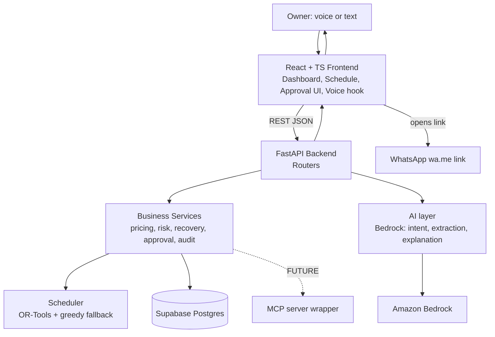

# OperAI: System Architecture

Amazon Developer Hackathon 2026, Alexa+ track. Companion to the OperAI PRD.

Design principle: **one FastAPI service, one Postgres DB, one LLM provider.** No microservices, queues, or caches. Everything is labelled **MVP** or **FUTURE**.

## 1. Tech stack (and why)

| Choice | Why needed | Why chosen | Why simpler option rejected |
| --- | --- | --- | --- |
| React + TypeScript + Vite | Interactive UI (schedule board, option cards, voice) | Fast setup; types help the AI coding agent catch API mismatches | Plain HTML/JS gets messy once you have a board, state, and voice |
| FastAPI (Python) | Backend logic, solver, Bedrock calls | Python has OR-Tools and boto3; auto-generates `/docs`, so the frontend dev can test the API | Node would mean rewriting the solver ecosystem |
| Supabase Postgres | Persistent state, transactions | Free hosted Postgres, SQL editor, easy seed data | SQLite or JSON files can't be shared by two devs or deployed cleanly. Firebase has no relational joins or transactions |
| SQLAlchemy 2.0 + psycopg (direct DB connection) | Approval must be atomic and idempotent | Supports real transactions and row locks | `supabase-py` goes through REST, which can't run multi-step transactions safely |
| OR-Tools CP-SAT (+ greedy fallback) | Guaranteed-feasible scheduling | Runs in-process, no extra service | An LLM can't guarantee feasibility. Hand-rolled loops can't replan well |
| Amazon Bedrock (boto3 Converse API) | Intent parsing, order extraction, explanations | Fits the AWS-flavoured hackathon; supports tool use | Another LLM vendor weakens the Amazon story |
| Browser Web Speech API | Voice in/out | Zero cost, zero backend | Polly/Transcribe adds AWS setup and latency for no MVP gain |

## 2. Frontend architecture (MVP)

Single-page app, no global state library (React state plus one `api.ts` client).

- **Pages:** Dashboard (brief + impact card), Schedule (before/after board), Orders (list + WhatsApp paste), Pricing, Audit Log
- **Voice layer:** `useVoice` hook (listen, speak, text fallback). It sends transcript text to `/api/agent/chat`
- **Approval UI:** option cards with an explicit "Confirm option N" button. Voice says the same words, and both hit the same endpoint
- **Mock mode:** a `VITE_USE_MOCKS` flag so the frontend dev builds against fake JSON until the real endpoints are live

## 3. Backend architecture (MVP)

Three layers, strictly separated:

1. **Routers** (HTTP only): validate input, call services
2. **Services** (all business logic, deterministic): `pricing`, `scheduler`, `risk`, `recovery`, `approval`, `audit`
3. **AI layer** (`bedrock.py`): intent, extraction, explanation

**Critical safety rule: the LLM can never call approve.** Its tools are read/propose only (`get_brief`, `propose_recovery`, `analyze_price`, `extract_order`). Approval is a separate endpoint triggered by the owner's explicit confirm, with the option number parsed by plain code.

Why this structure: services are plain functions, so the same ones can later be wrapped as MCP tools or called by a background job without rewriting. Why not one big `main.py`: it becomes untestable and the AI coding agent will tangle it.

## 4. Database

Postgres, 9 tables. Every table has `kitchen_id` (single kitchen now, multi-kitchen later at zero migration cost) and a `data_source` field (`simulated` or `verified`) on seeded data.

| Table | Purpose |
| --- | --- |
| `kitchens` | Burner/cook counts, overhead %, commission % |
| `ingredients` | Stock qty, unit, cost/unit |
| `menu_items` | Dish, price, packaging cost, prep time |
| `recipe_items` | Dish to ingredient quantities (needed for risk math) |
| `substitutions` | Owner-approved substitutes, allergen/diet tags, `needs_consent` |
| `orders` (+ `order_items`) | Customer, items, deadline, status |
| `plan_tasks` | Scheduled tasks (burner, cook, start/end, locked flag) |
| `proposed_actions` | Option payload (JSON), impact numbers, `status` (pending/approved/executed/rejected/expired), `plan_version` |
| `audit_logs` | Action, before/after snapshots (JSON), timestamp. Append-only |

**Approval correctness:** in one transaction, lock the `proposed_actions` row, reject if status isn't `pending` (idempotency), compare `plan_version` and stock to proposal time (revalidation), apply the change, write the audit log. Undo creates a new pending action built from the stored "before" snapshot.

Why JSON snapshots, not event sourcing: undo only needs "before", and event sourcing is far too heavy for a week.

## 5. Authentication

- **MVP:** none for users. A single seeded demo kitchen. The backend requires a shared `X-API-Key` header (env var) so the deployed API isn't wide open.
- **FUTURE:** Supabase Auth (JWT) with `kitchen_id` taken from the token, plus row-level security.
- Why skip login now: it costs a day and no judge scores it. The `kitchen_id` column keeps the door open.

## 6. External services

| Service | Status | Notes |
| --- | --- | --- |
| Amazon Bedrock | MVP | Needs model access enabled in the AWS account/region. Do this first, it can take time |
| Supabase | MVP |  |
| WhatsApp `wa.me` link | MVP | Just a URL with prefilled text, no API |
| MCP server (Alexa+ route) | FUTURE / conditional | Thin wrapper over existing services if the track rules require it |
| Polly / WhatsApp Business API / supplier APIs | FUTURE |  |

## 7. AI/ML integration

| Component | MVP implementation | Guardrail |
| --- | --- | --- |
| Scheduling/replan | CP-SAT, greedy-by-deadline fallback | Fallback if solver fails or times out |
| Option generation | Apply each candidate action to a copy of state, re-solve, compare | Only valid actions generated |
| Option scoring | Weighted formula (lateness, margin, customer risk), weights in a config dict | Formula shown in UI |
| Substitution | Rule table first; LLM may suggest candidates that must pass tag checks | Never auto-applied |
| Order extraction | Bedrock to JSON, Pydantic validation, confidence, owner confirms | Pasted text is treated as data, not instructions |
| Intent and explanation | Bedrock with tool use; explanation prompt receives only computed numbers | Output never used as a source of figures |

**FUTURE:** adaptive weights from approval history, demand forecasting (only with real data).

## 8. Request/data flow (hero journey)

1. Owner opens the dashboard or says "what's my brief?"
2. Frontend sends the transcript to `POST /api/agent/chat`
3. Bedrock picks the tool `get_brief`
4. `risk` service compares stock vs tomorrow's recipe needs and returns at-risk orders and ₹ exposure
5. `recovery` service generates options, re-solving the schedule per option, and stores them as `proposed_actions` (pending)
6. Bedrock writes a spoken explanation from those numbers only
7. Frontend shows the impact card and speaks the options
8. Owner says "confirm option 2" and the frontend calls `POST /api/actions/{id}/approve`
9. `approval` service runs the atomic transaction (validate, apply, replan, audit)
10. Response returns the new plan plus before/after. The UI updates, and a customer message draft appears

## 9. Architecture diagram



## 10. Folder structure (monorepo)

```
operai/
├── backend/
│   ├── app/
│   │   ├── main.py            # FastAPI app, CORS, router registration
│   │   ├── config.py          # env vars
│   │   ├── db.py              # SQLAlchemy engine/session
│   │   ├── models.py          # tables
│   │   ├── schemas.py         # Pydantic request/response (= API contract)
│   │   ├── routers/           # menu, pricing, orders, plan, recovery, actions, audit, agent
│   │   ├── services/          # pricing, risk, scheduler, recovery, approval, audit
│   │   └── ai/                # bedrock.py, tools.py, prompts.py
│   ├── seed/                  # schema.sql, seed.py (labelled simulated/verified)
│   ├── tests/                 # approval, idempotency, scheduler tests
│   ├── requirements.txt
│   └── .env.example
├── frontend/
│   ├── src/
│   │   ├── api/               # client.ts, mocks/
│   │   ├── components/        # ImpactCard, OptionCard, ScheduleBoard, VoiceButton
│   │   ├── hooks/             # useVoice.ts
│   │   ├── pages/
│   │   └── types/             # mirrors backend schemas
│   └── .env.example
├── docs/                      # PRD, API contract
├── .gitignore
└── README.md
```

## 11. Security

- Secrets only in env vars; `.env` gitignored (add `.gitignore` before the first commit)
- The frontend never holds DB or AWS credentials. It talks only to the backend
- Enable RLS on Supabase tables with no public policies, so the anon key can't read anything
- Pydantic validation on every input; CORS restricted to the frontend origin
- **Prompt injection:** pasted WhatsApp text can contain instructions. Treat it as data, force structured output, validate, and never auto-apply an extraction
- Approval gate, revalidation, and idempotency are the main safety properties, so write tests for those first
- Audit log is append-only (no update/delete endpoints)

## 12. Deployment

- **Frontend:** Vercel or Netlify (static build)
- **Backend:** Render or Railway (one container). AWS credentials as env vars. Free tiers sleep, so warm it up before the demo
- **DB:** Supabase hosted
- **Fallback:** run everything locally for the recorded demo, so a deploy problem can't sink the submission
- Why not AWS ECS/Lambda: more setup, same result. Why no Docker/CI: optional. Add a Dockerfile only if the host needs it

## 13. NOW vs FUTURE

| MVP (build now) | FUTURE (design allows, don't build) |
| --- | --- |
| Single-kitchen, no login | Supabase Auth + multi-kitchen RLS |
| Risk brief, scheduler, recovery options, impact card | Demand forecasting, adaptive scoring weights |
| Browser voice + text fallback | Polly/Transcribe, real Alexa+ device |
| Approval, audit, undo | Role-based approvals for staff |
| WhatsApp paste extraction, `wa.me` drafts | WhatsApp Business API, delivery-app integrations |
| Seeded/simulated data (labelled) | Live inventory sync, supplier ordering |
| Direct service functions | MCP server wrapping the same services |

## Biggest risks

- **Bedrock model access:** enable it immediately
- **The scheduler:** keep the greedy fallback ready
- **The approval transaction:** test it early
